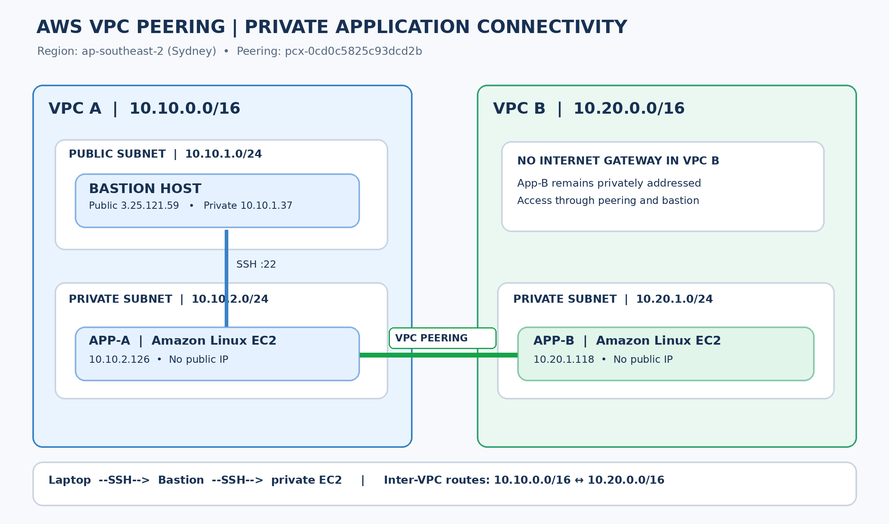

# AWS VPC Peering — Private EC2 Connectivity

**Project:** EWB AWS VPC Peering | **Author:** Shreeyash Kamble  
**Region:** `ap-southeast-2` (Sydney)

## Overview

This project implements private connectivity between two isolated AWS Virtual Private Clouds using an active VPC peering connection. A public bastion host provides administrative SSH access to private application EC2 instances; cross-VPC application traffic stays on private addresses.

## Network inventory

| Resource | Configuration |
|---|---|
| VPC A | `vpc-00610125adee37d31`, `10.10.0.0/16` |
| VPC B | `vpc-028e2566aa68b8e59`, `10.20.0.0/16` |
| VPC peering | `pcx-0cd0c5825c93dcd2b` (active when captured) |
| Public subnet A | `10.10.1.0/24` |
| Private subnet A | `10.10.2.0/24` |
| Private subnet B | `10.20.1.0/24` |
| Bastion | `3.25.121.59` public, `10.10.1.37` private |
| App-A | `10.10.2.126` private |
| App-B | `10.20.1.118` private |

## Routing and access

- VPC A's relevant route tables point `10.20.0.0/16` to the peering connection.
- VPC B's private route table points `10.10.0.0/16` to the peering connection.
- The public subnet in VPC A has an internet gateway route for bastion access.
- Security groups permit scoped SSH and ICMP flows. No public IPv4 addresses are assigned to App-A or App-B.

## Validation

- SSH from a local workstation to the bastion, then SSH to private instances.
- App-A → App-B ICMP: previously observed 4/4 responses, 0% packet loss.
- App-B → App-A ICMP: previously observed 4/4 responses, 0% packet loss.
- Controlled failure/recovery procedure: temporarily remove App-B inbound ICMP Echo Request from `10.10.2.126/32`, test ping failure, then restore and retest. See the report for the evidence caveat and validation narrative.

## Repository contents

- [`docs/Final_Project_Report.pdf`](docs/Final_Project_Report.pdf) — submission-ready technical report
- [`architecture/`](architecture/) — high-resolution topology diagram
- [`screenshots/`](screenshots/) — selected original AWS console and terminal captures

## Security notes

**Never commit** `.pem` keys, AWS credentials, access tokens, SSH agent material, or `.aws` configuration. AWS resource identifiers and historical IP addresses are documented for the project; verify that all running infrastructure has been cleaned up after evaluation to avoid charges.

## Reproduction outline

Create the two non-overlapping VPCs and subnets, attach an internet gateway to VPC A, launch the bastion and private instances, establish and accept VPC peering, add reciprocal routes, configure scoped security groups, and test both SSH and ICMP connectivity. See the PDF for details.
